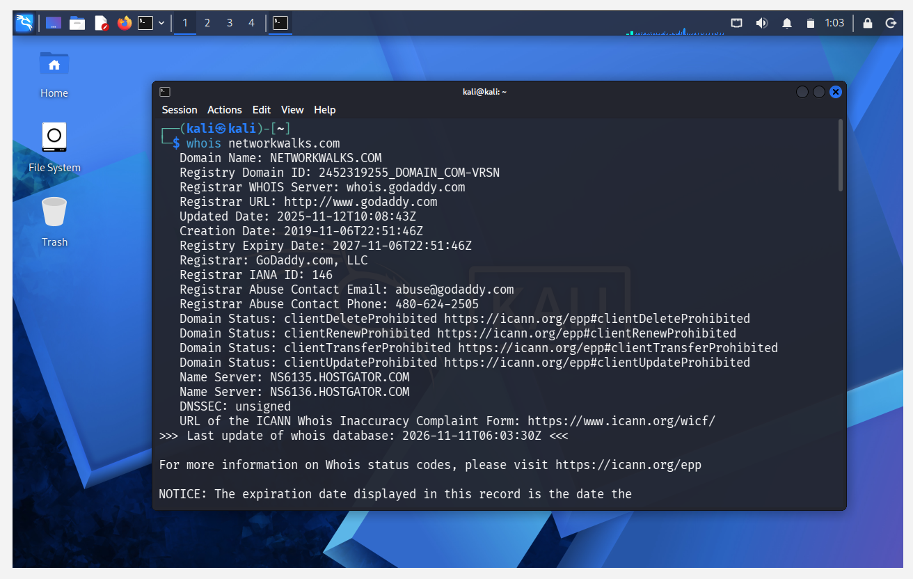
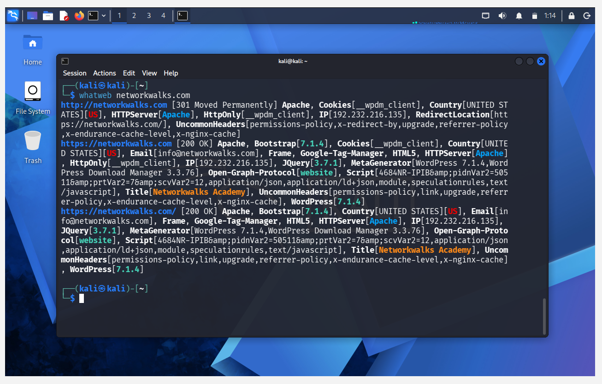
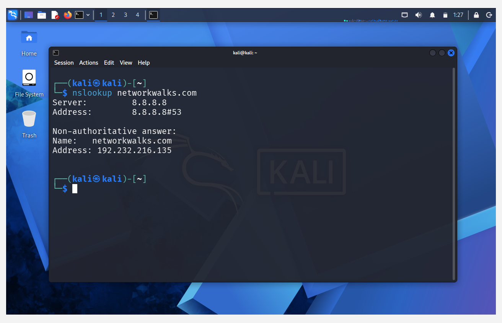
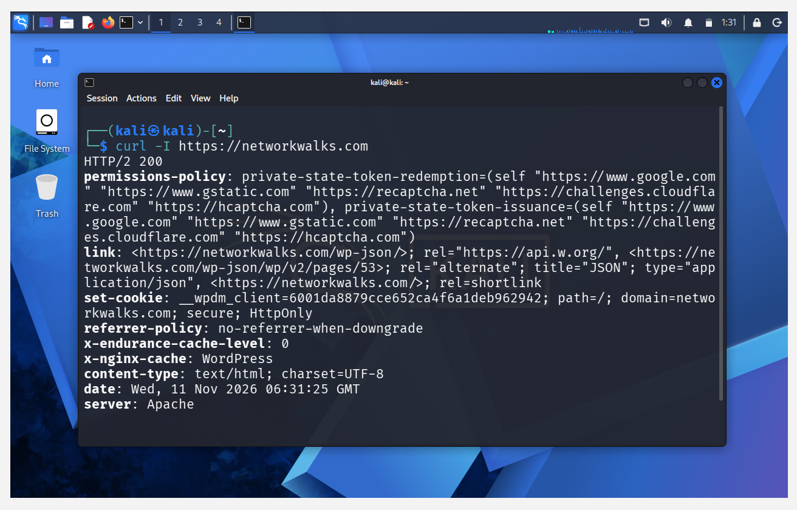
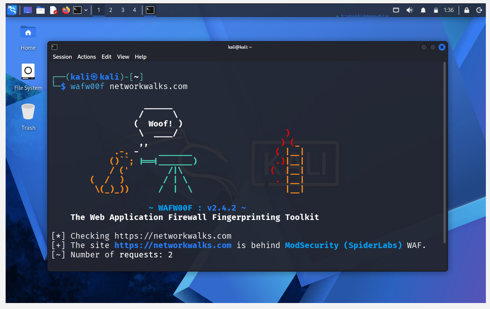
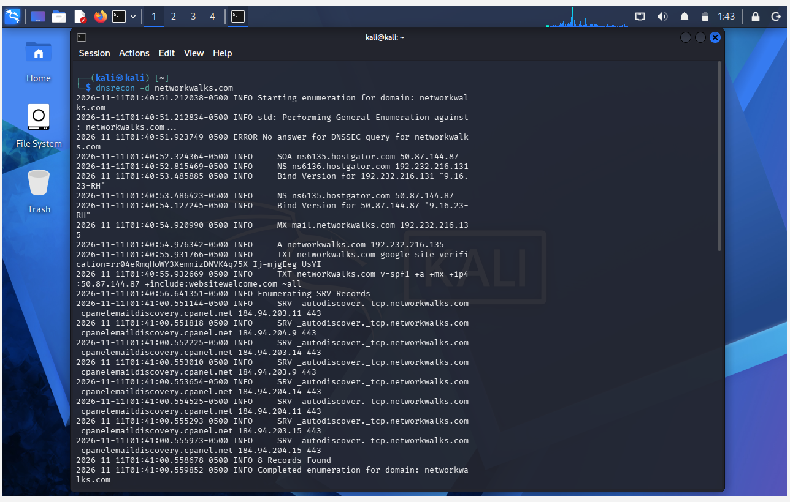
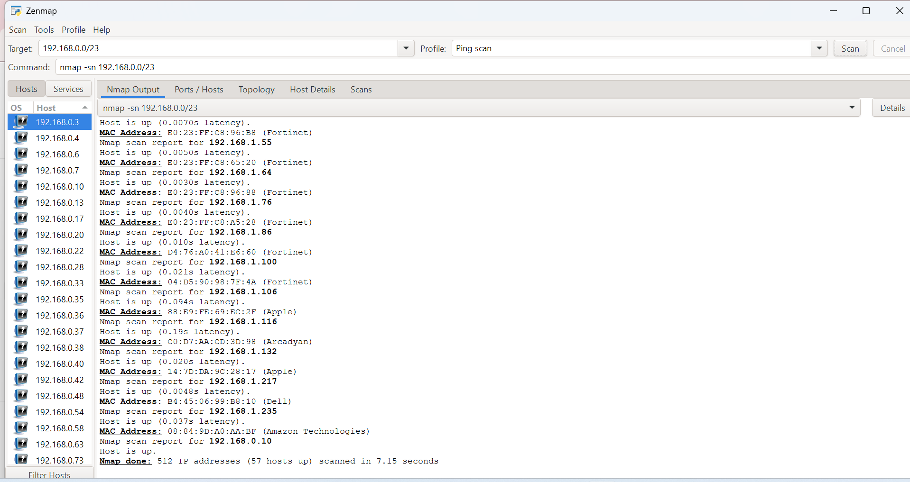
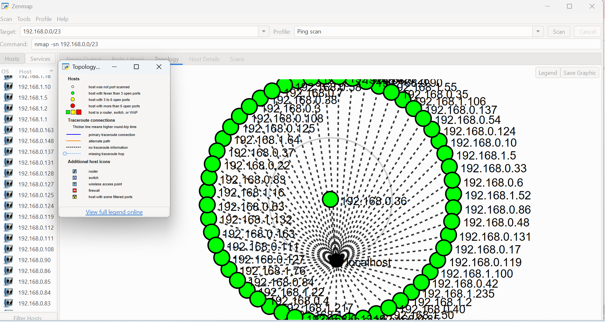

# Week-02-Footprinting-Reconnaissance-Network-Scanning# Week 02 – Footprinting, Reconnaissance & Network Scanning

## Cybersecurity Internship | Networkwalks

This repository contains the practical work completed during Week 02 of my Cybersecurity Internship at Networkwalks.

The activities covered two practical modules:

- **W2-PM1:** Footprinting and Reconnaissance using Kali Linux tools.
- **W2-PM5:** Network Scanning and Network Discovery using Zenmap.

The practicals focused on gathering publicly available information, identifying website technologies, enumerating DNS records, discovering active network hosts, and visualising network topology.

---

## Objectives

- Understand the fundamentals of footprinting and reconnaissance.
- Collect publicly available domain information.
- Identify website technologies and frameworks.
- Perform DNS lookup and DNS enumeration.
- Inspect HTTP response headers.
- Detect Web Application Firewall technology.
- Discover active devices on a local network.
- Identify IP and MAC addresses.
- Generate a network topology using Zenmap.

---

## Lab Environment

| Parameter | Details |
| --- | --- |
| Pentester | Asmita Ashok Devkar |
| Internship | Networkwalks |
| Program/Batch | B084-Networkwalks |
| Week | 02 |
| Operating System | Kali Linux and Windows |
| Target Domain | networkwalks.com |
| Target IP | 192.232.216.135 |
| Local Network | 192.168.0.0/23 |
| Date | 11 November 2026 |

---

## Authorization and Scope

All activities were performed only on systems and networks for which written permission was secured, or which I own.

The footprinting activity was performed against the assigned Networkwalks domain with written permission. Network scanning was performed on my own local LAN.

These exercises were conducted for educational and research purposes. No exploitation or unauthorized access was performed.

---

# Practical 1 – Footprinting and Reconnaissance (W2-PM1)

Six Kali Linux tools were used to gather information about the target domain.

## 1. WHOIS – Domain Information Gathering

**Objective:** To collect publicly available domain registration information.

**Command:**

```
whois networkwalks.com
```

**Observations:**

- Registrar: GoDaddy.com, LLC
- Domain created on 2019-11-06 and expires on 2027-11-06
- Name servers: NS6135.HOSTGATOR.COM and NS6136.HOSTGATOR.COM
- DNSSEC: unsigned

**Security significance:** Domain registration information helps security professionals understand domain ownership, hosting infrastructure and name servers.



## 2. WhatWeb – Website Technology Identification

**Objective:** To identify technologies and frameworks used by the target website.

**Command:**

```
whatweb networkwalks.com
```

**Observations:**

- Web server: Apache
- WordPress 7.1.4
- WP Download Manager 3.3.76
- Server IP: 192.232.216.135
- The HTTP site redirects (301) to HTTPS

**Security significance:** Technology fingerprinting helps identify the software used by a website and which components may require security review.



## 3. Nslookup – DNS Lookup

**Objective:** To resolve the target domain into its IP address.

**Command:**

```
nslookup networkwalks.com
```

**Observation:**

```
Domain: networkwalks.com
Resolved IP: 192.232.216.135
```

**Security significance:** DNS lookup identifies the IP address associated with a domain and is a basic step in reconnaissance.



## 4. cURL – HTTP Response Analysis

**Objective:** To inspect the HTTP response headers returned by the website.

**Command:**

```
curl -I https://networkwalks.com
```

**Observations:**

- Response: HTTP/2 200
- Server: Apache
- WordPress REST API endpoint exposed: `/wp-json/`
- Additional headers such as permissions-policy and referrer-policy were returned

**Security significance:** HTTP response analysis shows what information a web server exposes and supports further security assessment.



## 5. Wafw00f – Web Application Firewall Detection

**Objective:** To identify whether a Web Application Firewall protects the website.

**Command:**

```
wafw00f networkwalks.com
```

**Observation:**

```
Detected WAF: ModSecurity (SpiderLabs)
```

**Security significance:** Identifying the WAF reveals information about the defensive mechanisms used by a website.



## 6. DNSRecon – DNS Enumeration

**Objective:** To enumerate DNS records associated with the target domain.

**Command:**

```
dnsrecon -d networkwalks.com
```

**Records examined:** SOA, NS, MX, A, TXT, SPF and SRV.

**Key observations:**

- Two name servers were identified (ns6135.hostgator.com and ns6136.hostgator.com).
- Mail server found: mail.networkwalks.com.
- The domain resolves to 192.232.216.135.
- Google site verification TXT record identified.
- SPF record configured.
- Email autodiscovery SRV records identified (cPanel).
- 8 records were found in total.
- No answer was received for the DNSSEC query.

**Security significance:** DNS enumeration helps understand domain infrastructure, mail configuration and publicly exposed DNS information.



---

# Practical 2 – Network Scanning Using Zenmap (W2-PM5)

## Objective

To identify the local network configuration, discover active hosts, collect IP and MAC address information, and generate a network topology.

**Tools Used:**

- Windows Command Prompt (`ipconfig`)
- Nmap
- Zenmap

## Network Details

| Parameter | Result |
| --- | --- |
| Network Subnet | 192.168.0.0/23 |
| Scan Type | Ping Scan |
| Total IP Addresses Scanned | 512 |
| Active Hosts Found | 57 |
| Scan Duration | 7.15 seconds |

## Command Used

```
nmap -sn 192.168.0.0/23
```

**Command explanation:**

- `nmap` – network exploration and security auditing tool.
- `-sn` – host discovery only, without a port scan.
- `192.168.0.0/23` – the local network range that was scanned.

## Active Hosts Discovered

57 live hosts were found. A few examples:

| No. | IP Address | Observation |
| --- | --- | --- |
| 1 | 192.168.0.3 | Fortinet device |
| 2 | 192.168.0.4 | Live host |
| 3 | 192.168.0.6 | Live host |
| 4 | 192.168.0.7 | Live host |
| 5 | 192.168.1.55 | Fortinet device |
| 6 | 192.168.1.116 | Apple device |
| 7 | 192.168.1.132 | Arcadyan device |
| 8 | 192.168.1.235 | Amazon Technologies device |

**Additional observations:**

- MAC address vendors seen in the results include Fortinet, Apple, Dell, Arcadyan and Amazon Technologies.
- Many hosts belong to the same vendor, which suggests managed network equipment on the LAN.

## Network Topology

After completing the scan, the **Topology** tab in Zenmap was used to visualise the discovered network. The legend was enabled and the topology was saved.

**Importance of network mapping:**

- Helps identify active devices.
- Provides an overview of the network structure.
- Helps maintain a device inventory.
- Supports network monitoring and security assessment.

## Evidence – Network Scanning

### 1. Zenmap Host Discovery



### 2. Zenmap Network Topology



---

# Consolidated Findings

| Tool | Purpose | Key Observation |
| --- | --- | --- |
| WHOIS | Domain information gathering | Registrar and name server information |
| WhatWeb | Technology fingerprinting | WordPress 7.1.4 and WP Download Manager 3.3.76 |
| Nslookup | DNS lookup | 192.232.216.135 |
| cURL | HTTP response analysis | `/wp-json/` endpoint observed |
| Wafw00f | WAF detection | ModSecurity (SpiderLabs) |
| DNSRecon | DNS enumeration | NS, SOA, MX, A, TXT, SPF and SRV records |
| Nmap / Zenmap | Network discovery | 57 active hosts on 192.168.0.0/23 |

---

# Risk Analysis

The practical exercises revealed information that could be useful during reconnaissance.

| Finding | Potential Impact | Risk Level |
| --- | --- | --- |
| Website technology information exposed | Helps identify software requiring security review | Medium |
| Server IP address identifiable | Provides information about hosting infrastructure | Low |
| HTTP technical information exposed | May assist further technology fingerprinting | Low |
| WAF technology identifiable | Reveals information about security architecture | Low |
| DNS infrastructure information exposed | Helps build an infrastructure profile | Medium |
| Multiple live hosts visible on local network | Unexpected devices may require investigation | Medium |

**Note:** These are observations from information gathering and host discovery, not confirmed vulnerabilities. No exploitation or vulnerability validation was performed.

---

# Security Recommendations

1. **Review publicly exposed technology information:** Regularly review what information about web technologies and plugins is publicly visible.
2. **Keep software updated:** Update CMS platforms, plugins and other website components.
3. **Review HTTP headers:** Check whether unnecessary technical information is exposed.
4. **Review DNS records:** Ensure only required DNS information and services are publicly exposed.
5. **Configure and monitor the WAF:** Keep ModSecurity enabled and regularly review its configuration.
6. **Perform regular network discovery:** Periodically identify active devices on internal networks.
7. **Investigate unknown devices:** Verify unexpected devices discovered during network scanning.
8. **Maintain network documentation:** Keep network topology and device information updated.
9. **Perform authorised security testing:** Conduct reconnaissance and scanning only within the approved scope.

---

# Learning Outcomes

Through these practical exercises, I gained hands-on experience in:

- Domain footprinting and reconnaissance.
- WHOIS information gathering.
- Website technology identification using WhatWeb.
- DNS resolution using Nslookup.
- HTTP response analysis using cURL.
- WAF detection using Wafw00f.
- DNS enumeration using DNSRecon.
- Network discovery using Nmap.
- Network topology visualisation using Zenmap.
- Documenting technical findings and potential security risks.

---

# Conclusion

Week 02 provided practical exposure to footprinting, reconnaissance, DNS enumeration, website technology identification and network scanning.

Using multiple Kali Linux tools helped me understand how publicly available information can be collected and analysed during the initial stages of a cybersecurity assessment.

The Zenmap practical helped me understand local network discovery, active host identification and network topology visualisation.

These exercises strengthened my understanding of information gathering, network discovery and the importance of performing security assessments within an authorised scope.

---

## Project Report

The detailed Week 02 practical report, including methodology, tools used, observations, scan results and recommendations, is available here:

[Networkwalks-report-week-2.pdf](Networkwalks-report-week-2.pdf)

---

## Author

**Asmita Ashok Devkar**
Cybersecurity Intern – Networkwalks
**Program/Batch:** B084-Networkwalks
**Domain:** Cybersecurity
**Week:** 02
**Modules:** W2-PM1 and W2-PM5
